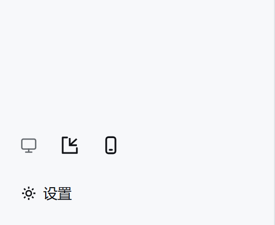

# DSH 插件 UI 约定

**Unofficial community conventions for DeepSeek Harness plugin UI.**

> ⚠️ **非官方**：本仓库由社区成员维护，不是 DeepSeek 官方规范，未经官方审核或推荐。引用时请保留这一说明。
>
> 状态：`sidebar.footer.action`（侧栏底部入口）章节为 **v1.0 · 已实践** —— 三个插件按它实现并发布了正式版；其余章节为 **草案（draft）**，可以讨论，但不要当成承诺。

## 为什么需要它

DSH 的侧栏、面板等区域由宿主提供容器，插件往同一个容器里塞自己的入口。一旦有两个以上插件占据同一区域，各自定义的几何会立刻变成视觉噪音：同一排出现 36 / 42 / 49 三种高度、8 / 12 / 50% 三种圆角、有的带字有的不带字。

这些问题的根因是同一个：**宿主容器只提供位置，不提供尺度**。于是每个插件都自己解一次，解法还互相冲突——有人给宿主行注入 `flex-wrap`，有人用 `:has()` 改宿主，有人把入口做成 49px 高。

本约定把这些共享容器里的**尺寸、间距、圆角、容量判定、排列顺序**写死成一张可被引用的表。插件只需要照表实现，不需要知道邻居是谁。

## 适用边界

| 是 | 不是 |
|---|---|
| 约定插件在**宿主提供的共享容器**里该长什么样 | 不要求宿主改布局，也不代表官方路线 |
| 只覆盖**有实践验证**的部分，其余标 `草案` | 不是完整设计系统，不覆盖业务功能 |
| 可以被 issue / PR 永久引用的稳定文本 | 不是插件评审标准，不构成准入门槛 |

## 章节

| 章节 | 内容 | 状态 |
|---|---|---|
| [00 · 基本原则](conventions/00-principles.md) | 五条硬原则：不改造宿主容器、单一判定输入、全有或全无…… | v1.0 |
| [10 · 宿主 token 与尺度基准](conventions/10-host-tokens.md) | 侧栏间距 token、圆角梯级、行高与图标尺寸 | v1.0 |
| [20 · 侧栏底部入口（footer.action）](conventions/20-sidebar-footer.md) | 两态几何、容量规则、order 档位、适配指南、反模式、窄屏/触屏图标态、纵向列与文案 | **v1.2 · 已实践** |
| [25 · 卡片型占用者](conventions/25-card-occupants.md) | 卡片型（信息卡/数据卡）与按钮型共存的三种形态与硬规则；25.6 纵向栈/窄栏降级 | v1.2 · 方案 A + 纵向栈分支 |
| [30 · 面板与浮层](conventions/30-panels.md) | 宽度档位、圆角、内边距 | 草案 |
| [40 · 状态、焦点与可访问性](conventions/40-states-and-a11y.md) | 焦点环、hover/active、图标态的命名 | v1.0（部分） |
| [90 · 参考实现](conventions/90-reference-implementations.md) | 已采纳插件的版本、代码位置、实测数字 | v1.0 |

## 已验证的采纳情况

| 插件 | 版本 | 落地提交 |
|---|---|---|
| [`dsh-chat-import`](https://github.com/Nwflower/dsh-chat-import) | 0.26.8 | `52da14e`（issue #120） |
| [`ds-harness-remote`](https://github.com/liguobao/ds-harness-remote) | 0.6.7 | `206c25e`（PR #498，issue #462） |
| [`dsh-mobile`](https://github.com/saya-ch/dsh-mobile) | 0.8.14 | `b794e32`（PR #452，issue #440） |
| [`dsh-cost-meter`](https://github.com/Han-1413141/dsh-cost-meter) | 1.9.86 | `PR #577`（issue #576）· 卡片型，§25 方案 A |

三个入口并排的效果（模拟宿主渲染：真实插件构建产物 + 宿主 CSS，非实机截图）：

## 怎么引用

在 issue / PR 里直接引用章节链接，例如：

> 本插件遵循 [DSH 插件 UI 约定 §20 侧栏底部入口](https://github.com/abworks-dev/dsh-plugin-ui-conventions/blob/main/conventions/20-sidebar-footer.md)（社区约定，非官方）。

## 给插件作者 / AI 助手：迁移 skill

`skills/dsh-ui-conventions/` 是一个给 agent 用的迁移助手，装上后可以让 AI 直接读着你插件的代码改：

- `SKILL.md` —— 判定按钮型 / 卡片型、套 §20 或 §25、删宿主改造、自检清单
- `scripts/audit.mjs` —— 只读审计：`node skills/dsh-ui-conventions/scripts/audit.mjs <插件仓库>`
- `references/footer-lane.ts` —— 可直接拷走的容量契约实现（MIT）

安装：把 `skills/dsh-ui-conventions/` 整个目录放到 DSH 的 skills 目录（`$DSH_HOME/skills/`）即可。

## 版本策略

- 语义化版本：`v1.x` 只做澄清与新增（不改已有数值）；改数值或改判定规则必须进 `v2.0`，并在 [CHANGELOG](CHANGELOG.md) 写明迁移方式。
- 约定数值如有真实反例（某个尺寸在真实宿主里不可行），请开 issue 附测量数据；本仓库只接受能复现的修正。

## 许可

[MIT](LICENSE)
