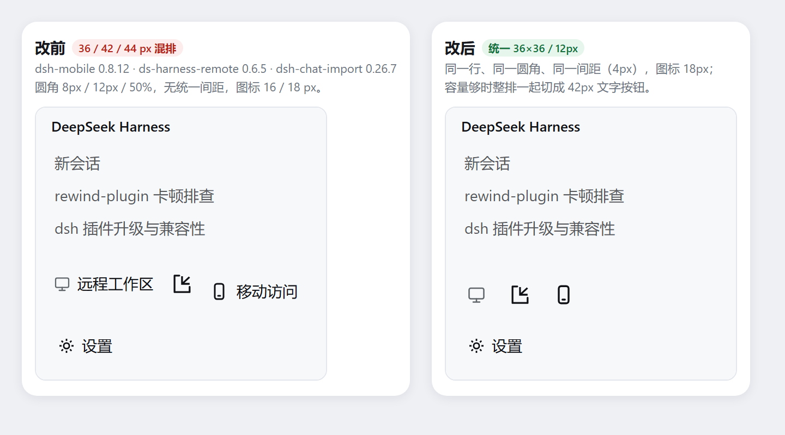
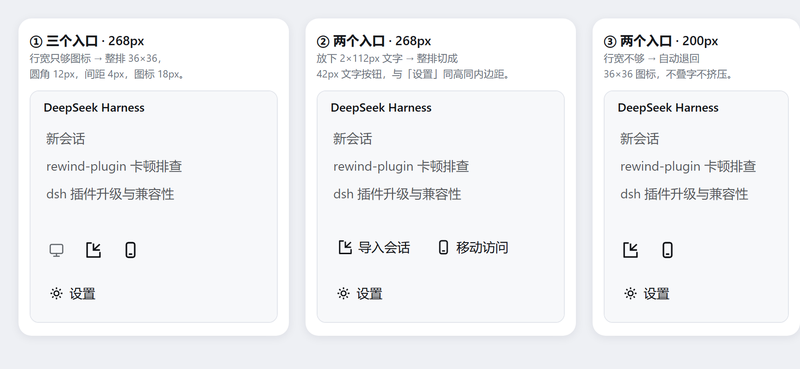
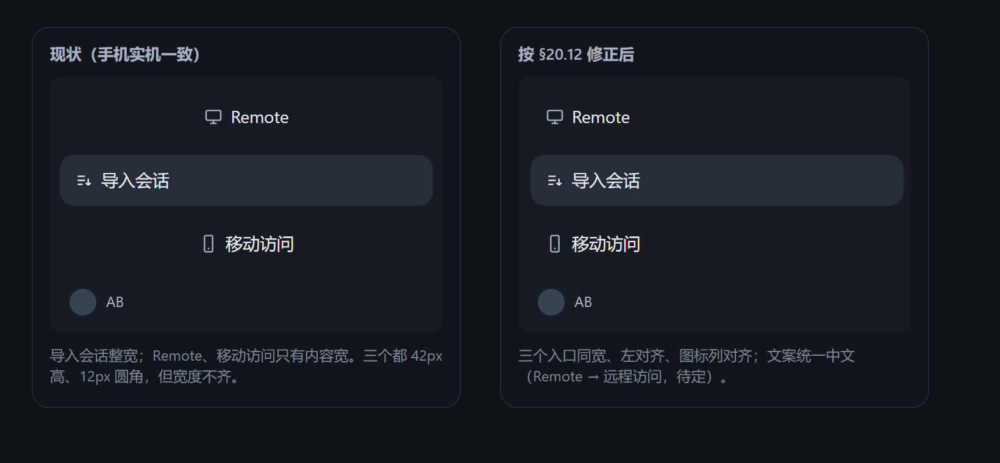

# 20 · 侧栏底部入口（`sidebar.footer.action`）

**状态：v1.0 · 已实践**（`dsh-chat-import` 0.26.8 / `ds-harness-remote` 0.6.7 / `dsh-mobile` 0.8.14 均按本章实现并发布）

---

## 20.1 容器事实

宿主提供的是一个**列表槽**，多个插件可以同时注册：

```
"sidebar.footer.action": { kind: "list", scope: "root", owner: { wide: boolean } }
```

渲染结构（`dsh-client-ui-sidebar`）：

```jsx
<div class="footArea">
  <div class="footerActions">{renderSlot("sidebar.footer.action", { wide })}</div>
  <div class="settingsArea">{renderSlot("sidebar.settings", { wide })}</div>
</div>
```

关键 CSS 事实：

| 事实 | 值 | 影响 |
|---|---|---|
| `.footerActions` | `display: flex`，**无 `gap`、无 `padding`、`nowrap`** | 间距必须由每个入口自己出 |
| 每个槽位外壳 | `[data-slot]` + `display: contents` | `clientWidth` 恒为 0，**不能用来测量** |
| owner props | 只有 `{ wide }`，**没有 `count`** | 入口数必须自己数 |
| `.collapsed .footerActions` | `justify-content: center; width: auto` | 折叠态（rail）由宿主居中，插件只负责 36×36 |

所以：**几何、间距、容量判定，全部由插件自己负责**。这正是本章存在的原因。

---

## 20.2 两态几何（MUST）

| 属性 | 文字态（label） | 图标态（icon） | 说明 |
|---|---|---|---|
| `height` | `42px` | `36px` | 文字态与设置行同高 |
| `width` | 由内容决定，`flex: 1 1 auto`（独占时撑满） | `36px`（`flex: 0 0 auto`） | ≥2 个占位时文字态改 `flex: 0 0 auto` + `width: auto` |
| `padding` | `0 calc(var(--dsh-sidebar-row-padding,12px) - var(--dsh-sidebar-paint-inset,3px))` | `0` | 见 §10 |
| `border-inline` | `var(--dsh-sidebar-paint-inset,3px) solid transparent` | `0` | 配 `background-clip: padding-box` |
| `border-radius` | `var(--dsw-radius-md,12px)` | `var(--dsw-radius-md,12px)` | **图标态也是 12px，不是 50%** |
| `gap` | `var(--dsh-sidebar-label-gap,6px)` | `0` | |
| `margin` | `4px 2px` | `4px 2px` | 两态一致，保证垂直位置不跳 |
| 图标 | `16 × 16` | `18 × 18` | 墨迹盒与画风见 §15 |
| 字号 | `14px / 22px` | — | |
| `justify-content` | `flex-start` | `center` | |
| 颜色 | `var(--dsw-alias-label-primary)` | `var(--dsw-alias-label-primary)` | 图标与文字同一 token；**不要用 `--dsw-alias-label-secondary`** |

### 状态

```css
/* hover */
background-color: var(--dsw-alias-interactive-bg-hover);
/* 焦点 */
outline: 2px solid var(--dsw-focus-ring-color, var(--dsw-alias-state-business-primary));
outline-offset: -2px;   /* 向内，避免被相邻入口裁掉 */
```

### 关于前景色（MUST）

入口的图标与文字统一用 `var(--dsw-alias-label-primary)`。官方 `ui-cordis` 的 footer 按钮（`.badge`）在文字态与 rail 图标态都用 `--dsw-alias-label-primary`；`dsh-mobile`、`dsh-chat-import`、`dsh-cost-meter` 三个已实践插件同样使用主标签色。

`--dsw-alias-label-secondary` 是给次要信息/禁用态用的；同排入口若用它，会在深色主题下比其它入口明显发灰（官方值：`label-primary` = `#f9fafb`，`label-secondary` = `#cfd3d6`），看起来像被禁用。激活/当前选中态可以切 `--dsw-alias-brand-primary`，但默认态不要降级。

### 关于 `margin: 4px 2px`

`4px` 竖直方向是为了和设置行 `.triggerRow { margin: 4px 0 }` 对齐；`2px` 水平方向是给相邻入口之间留下 4px 的最小间隙（两个相邻各出 2px），因为宿主容器没有 `gap`。

---

## 20.3 容量规则（MUST）

一排共享入口**全有或全无**：要么全带文字，要么全图标（见 §00 原则 3）。

### 公式

```
required(count) = count × 112 + (count − 1) × 4 + 16
```

- `112` = 单个入口的文字宽度上限（`FOOTER_MAX_LABEL_BOX`）
- `4` = 相邻入口间隙（两边的 `margin-inline: 2px` 相加）
- `16` = 行两端各 8px 的安全余量

### 判定

```
showLabel =
    count >= 1 && count <= 2
 && rowWidth >= required(count)
```

其余情况一律图标态。补充规则：

| 输入 | 结果 |
|---|---|
| `count <= 0`（还没测到） | 文字态（保守，先给文字，测到后再收） |
| `count > 2` | 恒图标态（三个及以上永远不显示文字） |
| `rowWidth` 非有限数 | 图标态 |
| 折叠态（rail，`wide === false`） | 恒图标态，不参与容量计算 |
| 容器不是横向行（`flex-direction` 非 row）或已换行（`flex-wrap` 非 nowrap） | 文字态，整宽显示（`width: 100%`） |

### 阈值参考

| count | required | 含义 |
|---|---|---|
| 1 | 128 | 侧栏宽 ≥ 128px 才带文字 |
| 2 | 244 | 两个入口都带文字需要 ≥ 244px |
| 3 | 360 | 永远不达（因为 count>2 恒图标） |

---

## 20.4 怎么测（`count` 与 `rowWidth`）

```js
// 1) 向上找到「真正的行」：跳过 display:contents 的外壳，也跳过单子元素的普通包裹层
let row = button;
while (row && row.parentElement) {
  const style = getComputedStyle(row.parentElement);
  if (style.display !== 'contents') {
    if (style.display.includes('flex')) break;
    if (row.parentElement.children.length > 1) break;
  }
  row = row.parentElement;
}

// 2) 数同排有几个占位：展开 display:contents 的子项，排除自己、排除不可见元素
//    （position 为 fixed/absolute，或 rect 宽高为 0 的一律不算）

// 3) 读宽度：row.clientWidth
```

**不要**读 `[data-slot]` 外壳的宽度（恒 0），**不要**测邻居按钮的宽度（循环依赖）。

变化监听（三路都要，缺一个就会在某些场景不刷新）：

| 触发源 | 观察对象 |
|---|---|
| `ResizeObserver` | 行 + 自己的按钮 |
| `MutationObserver` | 行的子树：`childList` / `subtree` / `attributes`（`style`、`class`、`hidden`） |
| `window` `resize` | 侧栏可拖拽调整宽度，必须响应 |

> 自己在回调里改 `class` 时要防重入（记录上一次的值，相同就不写），否则 `MutationObserver` 会被自己触发成环。

---

## 20.5 `order` 档位（SHOULD）

同一排里的先后顺序由注册时的 `order` 决定（升序，宿主渲染器支持）。按**入口的性质**分档，避免每个插件都抢第一位：

| 档位 | 用途 | 例子 |
|---|---|---|
| `0 – 19` | 账号 / 身份 / 连接 | `ds-harness-remote` 用 `0` |
| `20 – 39` | 会话 / 数据 / 内容 | `dsh-chat-import` 用 `20` |
| `40 +` | 设备 / 端 / 外设 | `dsh-mobile` 用 `40` |

---

## 20.6 适配指南（照着改，约 10 行）

1. 从参考实现里拷一份 `footer-lane` 纯函数模块（见 [§90](90-reference-implementations.md)），或自己实现 §20.3 的公式。
2. 入口组件加一个 `ref`，在 `useEffect` 里挂观察器，把 `resolveFooterForm(count, rowWidth)` 的结果映射成两个类：
   - 文字态 → 无额外类（或 `.is-shared`，当 `count > 1` 时改 `flex: 0 0 auto; width: auto`）
   - 图标态 → `.is-icon`
3. CSS 按 §20.2 的表抄两态。
4. 把渲染里「是否显示文字」的判断从 `props.wide` 改成 `props.wide && form === 'label'` —— **`wide` 是「侧栏展开」，不是「有空间放文字」，这两个必须拆开**。
5. 注册时给 `order` 一个符合 §20.5 的值。

---

## 20.7 反模式（真实案例）

| 反模式 | 实例 | 后果 |
|---|---|---|
| 给宿主行注入 `flex-wrap: wrap` | `zh667/TokenLedger`：`div:has(> [data-slot='sidebar.footer.action']){flex-wrap:wrap}` + 入口 `height:49px; margin:8px 0 0` | 改变了所有邻居的排布；49px 与 42px 行不同高 |
| 运行时改宿主行、卸载再还原 | `Ychris12138/dsh-usage-stats`（`lib/client.js`，为 issue #21/#82） | 逻辑更小心，但仍是改共享容器；与别的插件同时改会互相覆盖 |
| 用 `:only-child` 判定容量 | `dsh-mobile` 0.6.14–0.8.13：`:not(.is-rail):not(:only-child){flex:0 0 44px}` | 必然「一个带字、一个不带字」混搭；44×42 的尺寸也和 42px 行不同高 |
| 圆形按钮 | `Aisland-SJL/dsh-usage`：`border-radius:50%` | 一行里圆角不统一，观感割裂 |
| 图标态用 `50%` 圆角 | 上述三个插件 2026-11 之前都是 | 已在 v1.0 统一为 12px |

---

## 20.8 实测对照（模拟宿主渲染 + 真实插件构建产物）

改前（268px 侧栏，同一行三个入口）：

| 入口 | 尺寸 | 圆角 |
|---|---|---|
| `ds-harness-remote` | `108 × 36` | `8px` |
| `dsh-chat-import` | `36 × 36` | `50%` |
| `dsh-mobile` | `98 × 42` | `12px` |

改后：

| 场景 | 行宽 | 结果 |
|---|---|---|
| 三入口 | 268px（行 251px） | 三个 `36 × 36` / `12px` / 间距 4px |
| 两入口 | 268px | 各 `102 × 42`，pad `9px`、gap `6px`、`12px` |
| 两入口 | 200px（行 183px） | 退回 `36 × 36` |
| 折叠态 | — | `36 × 36` |





---

## 20.9 历史说明：44×42 从哪来、为什么被取代

`dsh-mobile` issue #237（2026-10-21，用户反馈「移动访问」和余额插件挤在一行）当天发的 0.6.14 引入了紧凑形态：与其他入口共用一行时用 44×42 无字方块，独占时恢复文字。

问题不在「有紧凑形态」，而在**判定维度**：它用 `:only-child` 判断「有没有邻居」，而不是「行里放不放得下」。于是只要有邻居就无条件收紧，两个入口时必然一个是 44×42 方块、一个是带字的 42px 行 —— 高度和宽度都对不齐。

v1.0 用「全有或全无 + 容量公式」取代它。如果将来确实需要第三种更小的中间态，应该是**在 42px 行体系内的新档位**（沿用 12px 圆角、9px 内边距），而不是回到 44 宽 × 42 高的方形。

---

## 20.10 卡片型占用者

本节只覆盖**按钮型**入口。如果占位元素是一张信息卡（多行、高度随内容变化、宽态 > 48px），不要套用本节的两态几何，见 [§25 卡片型占用者](25-card-occupants.md)（草案）。

---

## 20.11 窄屏 / 触屏：优先图标态（SHOULD）

判定条件（满足任一即视为窄屏 / 触屏）：`@media (pointer: coarse)` 命中，或视口宽度 ≤ 1023px，或宿主给 `<body>` 打了 `data-dsh-pocket-layout="mobile"`。

1. **默认走图标态**：36×36 / `border-radius: var(--dsw-radius-md,12px)` / 18px 图标 / `margin: 4px 2px`。不要退化成全宽卡片堆叠——三张卡会把 footer 从 36px 撑到 130px 以上，直接挤掉会话列表（见 §20.8 的实测对照）。
2. **保持单行**：入口多时横向滚动（`overflow-x: auto; overscroll-behavior-x: contain`），不换行、不纵向堆叠。
3. **明细内联展开**：展开区放在行下方，`max-height: min(38dvh, 320px)` + `overflow: auto`；窄屏不要用绝对定位浮层，容易被软键盘和安全区遮挡。
4. **不得静默回退**：应用不能用「当前是触屏 / 窄屏」这个理由把用户**显式选择**的图标布局改回卡片形态。只有用户没显式选择时，才允许回退默认形态。
5. **点击区不小于 36×36**（WCAG 2.5.8 最小 24；Apple HIG 建议 44）。行高固定 36px 时，需要更大点击区就加大图标或整块热区，不要加高行。

反模式（真实案例）：`if (nativeLayout()) return nodes` —— 用设备能力判断直接把图标布局整段回退成卡片，结果是设置里选了「图标」在手机上没有反应。

参考实现：`dsh-cost-meter` 1.9.88+（`src/sidebar-icons/`：`cm-icons-row` 单行 36px、`cm-icons-list` 横向滚动、`cm-icons-panel` 内联展开，触屏与桌面窄侧栏共用同一份几何）。

---

## 20.12 纵向列容器（手机侧栏浮层、窄栏堆叠）（MUST）

判定：离占位者最近的 footer 容器 `flex-direction` 不是 `row`（即 `column`）。与 §25.6 同一判据。

> 别用 `wide` 判断横排还是纵排：手机端侧栏是整屏宽的浮层，**宽度够，`wide` 为真，但 footer 是纵向列**。`wide` 只回答「文字放不放得下」，不回答「行是横的还是竖的」。

1. **每个占位者独占整行**：`width: 100%`（或 `align-self: stretch` + `flex: 0 0 auto`）。不要用 `flex: 0 0 auto` + `width: auto` / `fit-content` 把按钮缩到内容宽。
   真实案例（手机实机）：同一列里「导入会话」306px、「Remote」93.6px、「移动访问」102px —— 三个都 42px 高、12px 圆角，但宽度不齐，看起来像三个不同控件。
2. **`count` 不参与判定**：纵向列一行只放一个，§20.3 的 `required(count)` 只对横向行有意义，此处不得因为「有邻居」而收窄。
3. **几何沿用文字态**：42px 高、`border-radius: var(--dsw-radius-md)`、`padding-inline: calc(var(--dsh-sidebar-row-padding,12px) - var(--dsh-sidebar-paint-inset,3px))`、`gap: var(--dsh-sidebar-label-gap,6px)`、字号 14/22、左对齐、单行 `text-overflow: ellipsis`。
4. **图标态不用于纵向列**：整行宽度足够放文字；只有 rail（折叠侧栏，36px 宽）才用 36×36。
5. **仍禁止改宿主容器**：不得注入 `align-items` / `flex-direction` / `gap` / `order`。

**宿主注意**：手机浮层实测宿主列是 `align-items: center`。子项不显式写 `width: 100%` 就一定会缩到内容宽——这正是上面三个宽度不齐的直接原因。

```ts
// measureFooterLane / measureFooterSeat 已经给出 lane 事实
const stacked = !facts.lane
el('div', { className: `entry${wide ? ' isWide' : ' isRail'}${stacked ? ' isStacked' : ''}` }, ...)
```

```css
.entry.isStacked { width: 100%; flex: 0 0 auto; align-self: stretch; margin: 4px 2px; }
.entry.isStacked > .button { width: 100%; max-width: none; }
```



---

## 20.13 文案（SHOULD）

- 中文界面用中文文案，尽量不超过 4 个汉字；品牌名（如 `Remote`）可以保留，但应在 `title` / `aria-label` 里同时给出中文全称。
- 同一组入口的文案长度尽量一致（2 字或 4 字），不要中英混排——不一致不会影响宽度对齐（宽度由 §20.12 决定），但会影响视觉节奏。
- 文案改变不需要改几何；几何改变不需要改文案。
