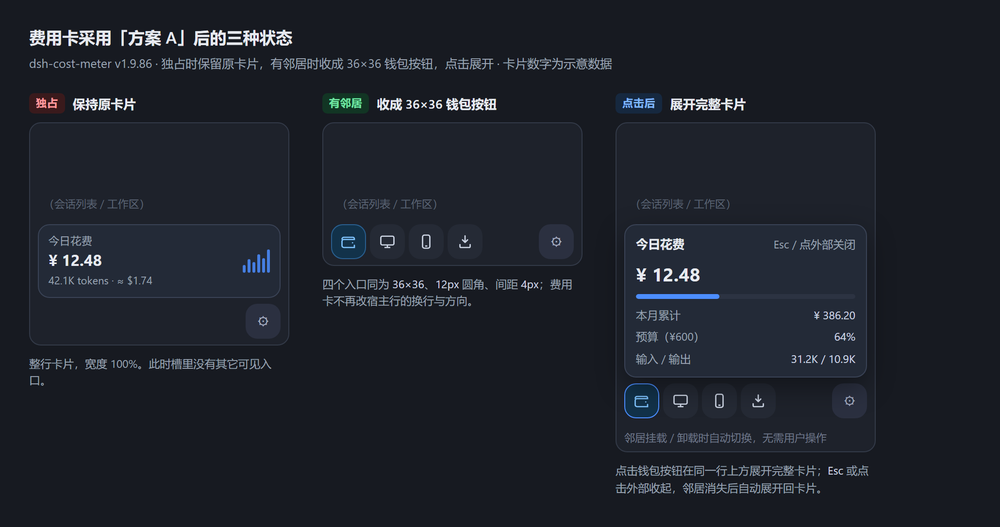
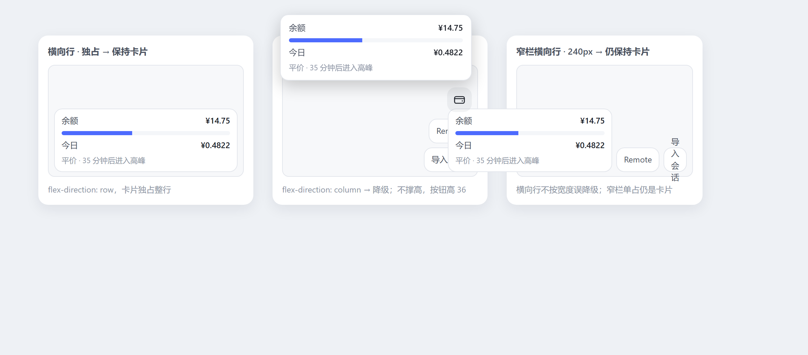

# 25 · 卡片型占用者（草案）

> 状态：**v1.2 · 方案 A 已实践 + 纵向栈分支（25.6）**（2026-11-24 起）。方案 A 已有第一个落地实现（`dsh-cost-meter` 1.9.86，见 [§90](90-reference-implementations.md)）；其余问题（高度上限、默认展开、排序归属、换行归属）仍待定。

## 1. 两种占用者的区别

| | 按钮型（§20） | 卡片型（本节） |
|---|---|---|
| 高度 | 42px（文字态）／36px（图标态） | 通常 > 42px，或内容多行、高度随内容变化 |
| 目的 | 进入某个页面 / 打开某个面板 | 直接展示常驻数据（余额、费用、额度） |
| 判定 | 只需 `count` + `rowWidth` | 高度不可预测，无法套用 §20 的容量公式 |

**判定规则**：占位元素在宽态下的自然高度 > 48px，或多行布局，即视为卡片型。卡片型**不得**声称自己遵循 §20 的两态几何。

## 2. 问题

`sidebar.footer.action` 的容器是 `display:flex` 的**单行**（`nowrap`）。一个 `width:100%` 的卡片会把同排其它入口推到容器右边界之外 —— 实测第二个入口的 `x` 落在 268（侧栏宽），渲染出来「opacity:1、可见、但完全在面板外」，用户看到的现象是「插件没加载」。

## 3. 三种可选形态

| | 形态 | 适用 | 代价 |
|---|---|---|---|
| **A** | 有邻居时降级为**按钮形态**（36×36 图标），卡片内容移入点击后的浮层/面板 | 推荐，默认；**已实践**：`dsh-cost-meter` 1.9.86（[§90](90-reference-implementations.md)） | 少了一眼可见的数字 |
| **B** | 卡片 `flex-wrap` 到**自己一行**，其它入口在下一行 | 卡片信息必须常驻时 | footer 高度 +约 52px；行数随插件数变化，位置仍会跳 |
| **C** | 卡片移出 footer，进入侧栏面板或设置页 | 数字属于「详情」而非「常驻信息」 | 同样少一眼可见的数字 |

形态由**插件作者**决定（这是产品判断），本节只规定三种形态各自的实现边界。

方案 A 落地后的三态（`dsh-cost-meter` v1.9.86）：

## 4. 硬规则

1. **`count > 1` 时禁止 `width:100%`**。槽内有其它占用者时，卡片必须进入 A 或 B 形态。
2. **禁止改造宿主容器**：不得用 `:has()` / 注入 CSS 去改 `.footerActions` 的 `flex-wrap`、`flex-direction`、`align-items`，也不得改 `sidebar.settings` 的 `order`、尺寸、圆角。卡片只能控制**自己的**盒子。
3. **必须提供按钮兜底**：卡片型插件必须能在 36×36 图标态下工作（点击后可完整访问卡片信息）。没有兜底的卡片型插件不允许进入该槽。
4. **B 形态只允许 wrap 到独立行**：不得通过缩小、挤压、`flex-shrink` 邻居来腾位置；不得让邻居的可见宽度小于 `required(1) = 128px`。
5. **卡片不计入 §20 容量公式**：`required(count)` 只统计按钮型占用者。卡片存在时，按钮型一律取图标态（36×36），因为卡片高度与宽度都不可预测。

## 5. 待定问题

> 跟踪 issue：[#1](https://github.com/abworks-dev/dsh-plugin-ui-conventions/issues/1)。四个问题都要等真实插件作者选定 A/B/C 形态后才能收敛。

- 卡片高度的上限（目前观察到 49px～自适应多行，是否需要封顶在 64px？）
- 卡片是否允许「默认展开」，还是必须默认收起为图标
- 卡片型占用者与按钮型占用者的排序（`order` 是否仍按 §20 的档位，还是卡片统一置顶/置底）
- B 形态下，`footerActions` 的 `flex-wrap` 由谁负责开（目前是插件各自注入，重复且会互相干扰）

## 6. 纵向栈（25.6）

> 触发来源：`dsh-cost-meter` 1.9.87 在手机端（DSH Mobile）侧栏的表现。手机端 footer 是**纵向栈**，方案 A 的「有邻居就收窄」按**同一横向 flex 行**的 `rowWidth` 判定，纵向时该判定永远不成立，卡片仍以 `width:100%` 铺满，把 Remote、导入会话等按钮挤到下方 —— 这是 §3 方案 A 的真空区。

### 6.1 判定：读实际 footer 布局容器的 `flex-direction`

| 环境 | 判定 | 卡片形态 |
|---|---|---|
| **横向行** | `row` / `row-reverse` | 按 §3 的方案 A 判定，不因侧栏窄就额外触发本节降级 |
| **纵向栈** | `column` / `column-reverse` | 36×36 按钮，点击访问卡片内容 |

从自己的占位元素向上找到**实际承载 footer 入口的 flex 布局盒**，跳过 `display: contents` 槽包装；可参考 [`measureFooterSeat`](../skills/dsh-ui-conventions/references/footer-lane.ts)。未找到布局盒不能当作纵向。这里判断的是排列方向，不是设备类型或视口宽度：桌面窄栏的独占横行仍可能放下整张卡片，而整屏宽的手机侧栏也可能是纵向栈。

### 6.2 降级形态（硬规则）

1. **入口几何不变**：36×36 按钮、18px 图标、`margin: 4px 2px`；沿用 [§10](10-host-tokens.md#圆角侧栏入口与展开内容分开) 的入口圆角，不改成正圆、窄条或更小的点击区。
2. **点击访问完整内容**：卡片明细默认用非模态锚定面板；如果展开的只是命令或选项，则用菜单。按钮是锚点，底部入口优先向上展开；组件选型、边界、关闭和焦点按 [§30](30-panels.md)，本节不另定浮层材质、圆角或固定宽高。§20.11 的窄屏内联明细、§20.12 的纵向列整行布局属于宿主自适应形态，命中时按 §20 执行，不改造成锚定浮层。
3. **自动恢复**：容器回到横向时关闭旧浮层，按 §3 重新判定卡片形态；不需重载，也不丢失卡片的数据状态。
4. **不改变 footer 或邻居**：展开内容不进入纵向栈的文档流，也不注入 `flex-direction` / `order` / `gap` 改宿主。这里只处理卡片降级；§20.11 自有横向图标条的内联明细规则不变。

### 6.3 参考实现

`dsh-cost-meter` v1.9.86 起已具备方案 A 的横向判定；纵向栈分支见 PR [#580](https://github.com/Han-1413141/dsh-cost-meter/pull/580)。实现要点：一个包裹组件持有 `chip` / `open` 两个状态，用 `ResizeObserver` 观测自身与最近的 footer 容器，把原有卡片节点在「行内」与「浮层内」之间整体搬移（不复制节点，避免两套状态）。

## 7. 讨论中的实例

| 插件 | 形态 | 状态 |
|---|---|---|
| [`dsh-cost-meter`](https://github.com/Han-1413141/dsh-cost-meter) | 纵向多行卡片，`width:100%`，最多注册 4 个节点 | **已按方案 A 落地**：v1.9.86（[PR #577](https://github.com/Han-1413141/dsh-cost-meter/pull/577)，issue [#576](https://github.com/Han-1413141/dsh-cost-meter/issues/576)） |
| [`dsh-ui-usage-billing`](https://github.com/kenz1117/dsh-ui-usage-billing) | 宽卡（`@container` 三级降级），`order:-10` | 讨论中（[#130](https://github.com/kenz1117/dsh-ui-usage-billing/issues/130)） |

方案 A 已落地（v1.1），纵向栈/窄栏分支见 §6（v1.2）；其余三个待定问题（高度上限、默认展开、排序归属）收敛后再小幅升版，并把最终形态补进 §20 的适配指南。
