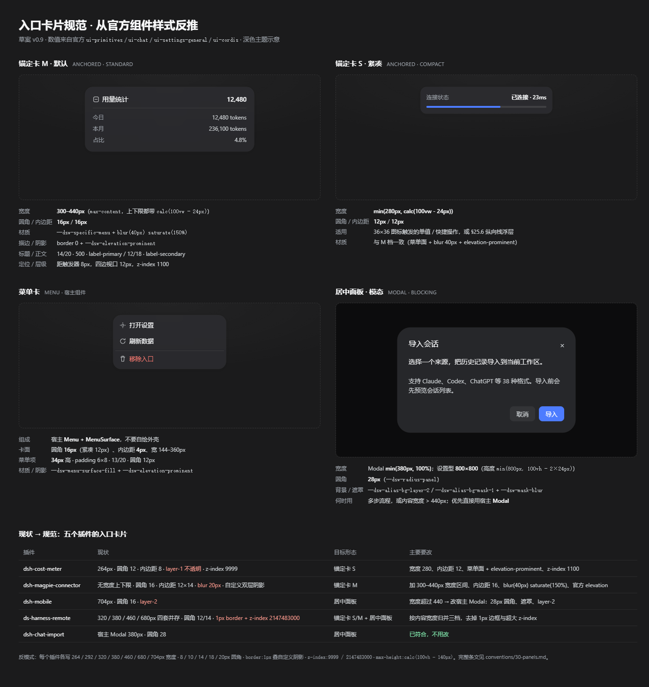

# 30 · 入口卡片与浮层

> 状态：**草案 v0.9 · 官方反推稿**（2026-11-26）。下面的数值全部从官方 `ui-primitives`、`ui-chat`、`ui-settings-general`、`ui-cordis` 的组件样式反推，尚无插件按此改造；等真实插件落地后再升 `v1.0`。

本节说的「入口卡片」是**点击侧栏（含底部 footer）入口后弹出的浮层**；footer 行内常驻的卡片型占用者不属于本节，见 [§25](25-card-occupants.md)。

## 30.1 三种形态与判定

| 形态 | 何时用 | 官方参照 | 关键特征 |
|---|---|---|---|
| **菜单卡** | 一组动作 / 选项 | `Menu` + `MenuSurface` | 直接复用宿主菜单，不自绘外壳 |
| **锚定卡（默认）** | 状态、数据、少量操作，内容宽度 ≤ 440px | `ui-chat/src/client/chat/stat-dialog.module.css`（触发器锚定 dialog） | 非模态、贴着触发器、无遮罩 |
| **居中面板** | 多步流程、设置、内容宽度 > 440px | `Modal` / `ui-settings-general` 的 `.panel` | 有遮罩、阻断页面、28px 圆角 |

判定顺序：能用菜单就不要做卡片 → 否则默认锚定卡 → 只有内容确实超过 440px 或必须阻断页面时才升级为居中面板。

锚定卡再分两档（沿用官方 `MenuSurface` 的 `surface` / `compact` 圆角梯级）：**S 紧凑卡**（宽度 `min(280px, calc(100vw - 24px))`、圆角 12px、内边距 12px，只用于 36×36 图标触发的单值 / 快捷操作）与 **M 标准卡**（默认，见 30.2）。

## 30.2 锚定卡（M 标准卡，默认形态，MUST）

| 项目 | 值 | 反推来源 |
|---|---|---|
| 圆角 | `var(--dsw-radius-lg)` = 16px | `stat-dialog.module.css` / `MenuSurface.module.css` |
| 内边距 | 16px | `stat-dialog.module.css:13` |
| 宽度 | `width:max-content`；`min-width:min(300px, calc(100vw - 24px))`；`max-width:min(440px, calc(100vw - 24px))` | `stat-dialog.module.css:10-12` |
| 最大高度 | `calc(100dvh - 12px - max(12px, var(--dsh-frame-overlay-top, 12px)))` | `stat-dialog.module.css:24` |
| 视口安全边距 | 四边 12px | `stat-dialog.module.css:30-33` |
| 与触发器距离 | 8px | `stat-dialog.module.css:31`（`calc(anchor(top) + 8px)`） |
| 背景 | `var(--dsw-specific-menu)` + `backdrop-filter: var(--dsw-menu-backdrop-filter)`（= `blur(40px) saturate(150%)`） | `stat-dialog.module.css:16-17`；`gradient-shadow-text.css:20` |
| 描边 / 阴影 | `border:0`；`--dsw-elevation-stroke-color: var(--dsw-alias-border-l1)`；`box-shadow: var(--dsw-elevation-prominent)` | `stat-dialog.module.css:14-19` |
| 正文字号 | 12px / 18px；`color: var(--dsw-alias-label-secondary)` | `stat-dialog.module.css:20-22` |
| 标题 | 14px / 20px，`font-weight:500`，`color: var(--dsw-alias-label-primary)` | `CordisPanel.module.css` 的 `.title`（官方插件入口面板） |
| 滚动 | 只有内容区滚动；`--dsh-scrollbar-thumb: var(--dsw-alias-scrollbar-bg-l2)`；`--dsh-scrollbar-thumb-hover: var(--dsw-alias-scrollbar-hover-l2)` | `stat-dialog.module.css:26-28` |
| 层级 | `z-index: 1100`（portal 层） | `stat-dialog.module.css:5`；`Menu.module.css` 的 `.portal` |

S 紧凑卡：宽度 `min(280px, calc(100vw - 24px))`；圆角 `var(--dsw-radius-md)` = 12px；内边距 12px；其余材质、阴影、字体与本表一致。§25.6 的纵向栈浮层即此档，按这里取值。

结构建议（与官方 `stat-dialog` 一致）：

- 标题行：`display:flex; justify-content:space-between; gap:16px; margin-bottom:8px`，左侧标题 + 图标（图标 14×14，gap 6px），右侧数值 `font-variant-numeric: tabular-nums`
- 标题下分隔线：`border-top: 0.5px solid var(--dsw-alias-border-l2); margin-bottom:10px`
- 内容区：两列信息表可用 `grid-template-columns: minmax(76px, auto) minmax(0, 1fr); gap:6px 16px`；标签 `label-tertiary`，值 `label-secondary`

行为与可访问性（MUST）：

1. 触发器：`aria-haspopup="dialog"`，`aria-expanded` 同步，`aria-controls` 指向浮层 id。
2. 浮层：`role="dialog"` + `aria-label`；**锚定卡是非模态的，不要写 `aria-modal="true"`**。
3. 关闭：`Escape`、浮层外 `pointerdown`、再次点击触发器都要关闭；点击浮层内部不关闭。
4. 焦点：打开时不强制移焦（保留在触发器），关闭时把焦点还给触发器；不做焦点陷阱、不锁页面滚动。
5. 定位：`position:fixed` 并 portal 到 `body`；优先显示在触发器上方（底部入口），空间不足翻到下方；任何情况下都保持 12px 视口边距，并在 resize / scroll 时重算最大高度。
6. 同一时刻只允许一个锚定卡打开；打开新的先关闭旧的。

## 30.3 居中面板（MUST）

当内容宽度超过 440px，或流程需要阻断页面时使用。

| 项目 | 值 | 反推来源 |
|---|---|---|
| 遮罩层 | `position:fixed; inset:0; z-index:1000`；居中；`padding:max(24px, var(--dsh-frame-overlay-top,24px)) 24px` | `Modal.module.css:6-15` |
| 遮罩 | `position:absolute; inset:var(--dsh-frame-chrome-top,0) 0 0`；`background:var(--dsw-alias-bg-mask-1)`；`backdrop-filter:var(--dsw-mask-blur)`；点击关闭 | `Modal.module.css:18-30` |
| 面板 | `border:0`；`border-radius:var(--dsw-radius-panel)` = 28px；`background:var(--dsw-alias-bg-layer-2)`；`box-shadow:var(--dsw-elevation-prominent)`；`overflow:hidden` | `Modal.module.css:33-48` |
| 对话框尺寸 | `width:min(380px, 100%)`；`padding:0 0 24px`；`gap:20px` | `Modal.module.css:39-48` |
| 标题 | 16px / 24px，`font-weight:500`，`label-primary` | `Modal.module.css:79-85` |
| 描述 | 14px / 22px，`label-primary` | `Modal.module.css:124-131` |
| 头部 / 主体 / 底部 | 头部 `padding:22px 14px 12px 24px`；主体 `margin-top:20px; padding:0 24px`；底部 `padding:0 24px; gap:8px; justify-content:flex-end` | `Modal.module.css:71-147` |
| 设置型面板 | `width:800px`；`height:min(800px, calc(100vh - 2 * max(24px, var(--dsh-frame-overlay-top,24px))))`；`max-width:calc(100vw - 48px)`；圆角 28px；背景 `layer-2` | `SettingsRoot.module.css:95-108` |

行为：优先直接用宿主 `Modal` 组件（自动处理 focus trap、Esc、遮罩点击、焦点归还）；不要自绘遮罩。`role="dialog"` + `aria-modal="true"`。

## 30.4 菜单卡（MUST）

如果卡片本质是一组命令/选项，直接使用宿主 `Menu` / `MenuSurface`，不要自绘卡片外壳：

| 项目 | 值 | 反推来源 |
|---|---|---|
| 卡面圆角 | `var(--dsw-radius-lg)` = 16px；紧凑变体 `var(--dsw-radius-md)` = 12px | `MenuSurface.module.css:1-8` |
| 卡面内边距 | 4px | `Menu.module.css:11` |
| 菜单项 | `min-height:34px; padding:6px 8px; border-radius:var(--dsw-radius-md); font-size:13px; line-height:20px` | `Menu.module.css:178-193` |
| 卡面宽度 | `min-width:min(144px, calc(100vw - 24px))`；`max-width:min(360px, calc(100vw - 24px))` | `Menu.module.css:33-34` |
| 卡面材质 | `var(--dsw-menu-surface-fill)` + `var(--dsw-menu-backdrop-filter)` | `MenuSurface.module.css:21-29` |
| 阴影 | `box-shadow: var(--dsw-elevation-prominent)`；`--dsw-elevation-stroke-color: var(--dsw-alias-border-l1)` | `Menu.module.css:16-17` |

`AccountMenu` 的已登录菜单就是官方范例：`AccountMenu.module.css` 里只调 `min-width/max-width/padding` 和菜单项高度，没有重画阴影与圆角。

## 30.5 禁止事项（反模式）

| 反模式 | 正确做法 |
|---|---|
| 每个插件各写 264 / 292 / 320 / 380 / 460 / 680 / 704px 的卡片宽度 | S 档 `min(280px, calc(100vw - 24px))`；M 档 300–440px；超过 440px 走居中面板 |
| 圆角出现 8 / 10 / 14 / 18 / 20px | 只有三档：锚定卡/菜单卡 `16px`，卡内子卡与菜单项 `12px`，居中面板 `28px` |
| `border:1px solid …` 叠自定义 `box-shadow` | `border:0` + `var(--dsw-elevation-prominent)`；需要发丝线时只重绑 `--dsw-elevation-stroke-color` |
| 锚定卡用不透明 `bg-layer-1` / `bg-layer-2` | 锚定卡必须用 `var(--dsw-specific-menu)` + `var(--dsw-menu-backdrop-filter)` |
| 自定义阴影 `0 8px 24px #0003` / `0 12px 34px rgb(15 23 42 / 13%)` | `var(--dsw-elevation-prominent)`（或 `--dsw-elevation-panel`，按下层类型） |
| `z-index: 9999` / `2147483000` | 锚定卡 `1100`；居中面板遮罩 `1000` |
| `max-height: calc(100vh - 140px)` 之类的硬编码 | `calc(100dvh - 12px - max(12px, var(--dsh-frame-overlay-top,12px)))` |
| 卡片内边距 8 / 10 / 18px | 锚定卡外沿 16px；卡内列表 12px |
| 字号 11 / 12 / 13 / 14 混排 | 标题 14/20·500；正文 12/18；说明 11/16 |
| 每个插件自己写遮罩/焦点管理 | 居中面板直接用宿主 `Modal`；菜单用宿主 `Menu` |

## 30.6 现状盘点（2026-11，作为迁移前基线）

| 插件 | 卡片选择器 | 宽度 | 圆角 | 内边距 | 背景 | 阴影 | 主要偏差 |
|---|---|---|---|---|---|---|---|
| `dsh-cost-meter` | `.cm-chip-pop` | `min(264px, 100vw-16px)` | 12px | 8px | `bg-layer-1`（不透明） | `0 8px 24px #0003` | 宽度低于 300、内边距 8、非菜单面、自定义阴影、`z-index:9999` |
| `dsh-magpie-connector` | `.dmg-sidebar-popover` | 未设上下限 | 16px | 12px 14px | `specific-menu` + `blur(20px)` | 自定义双层 | 无宽度上下限、内边距 12/14、blur 20px 非官方 40px saturate(150%)、自定义阴影 |
| `dsh-mobile` | `.dsh-mobile-control__panel` | `min(704px, 100vw-32px)` | 16px | 16px | `bg-layer-2` | `0 12px 34px …` | 宽度 704px 超过锚定卡上限，应改居中面板（28px 圆角 / `layer-2` / 遮罩）或收窄到 ≤440 |
| `ds-harness-remote` | `.dshRemoteRoutePanel` / `.dshRemoteHostReferencePanel` / `.dshRemoteConnectedPanel` / `.dshRemoteDialog` | 320 / 380 / 460 / 680px | 12 / 12 / 12 / 14px | 10×12 / 16 / 16 / 18px | `layer-1` / `layer-2` + 1px border | 各自自定义 | 四种面板规格并存、圆角 12/14、1px 边框、`z-index:2147483000` |
| `dsh-chat-import` | 宿主 `primitives.Modal` | `min(380px,100%)` | 28px | 24px（内容列） | `bg-layer-2` | `elevation-prominent` | 符合居中面板路径（弹的是导入向导，属模态流程） |

## 30.7 官方来源索引

| 组件 | 文件 | 关键行 |
|---|---|---|
| 触发器锚定 dialog（锚定卡） | `packages/client/ui-chat/src/client/chat/stat-dialog.module.css` | `:3-40` 面板几何；`:44-104` 标题/信息行 |
| 菜单表面 | `packages/client/ui-primitives/src/MenuSurface.module.css` | `:1-8` 圆角；`:21-29` 材质 |
| 菜单列表 | `packages/client/ui-primitives/src/Menu.module.css` | `:28-35` 宽度；`:178-193` 菜单项 |
| 模态 | `packages/client/ui-primitives/src/Modal.module.css` | `:6-48` 遮罩与面板；`:71-147` 头/体/底 |
| 设置面板 | `packages/client/ui-settings-general/src/client/SettingsRoot.module.css` | `:95-108` 800×800 面板 |
| 官方插件入口面板 | `packages/extensions/ui-cordis/src/client/CordisPanel.module.css` | `.panel`（420px / 12px 圆角 / 菜单面 / 60vh） |
| 阴影与 elevation | `packages/client/ui-theme/src/styles/gradient-shadow-text.css` | `:34-40` `--dsw-elevation-panel` / `--dsw-elevation-prominent` |
| 圆角 token | `packages/client/ui-theme/src/styles/design-platform.css` | `--dsw-radius-lg` 16 / `--dsw-radius-panel` 28 |

> 说明：官方 `ui-cordis` 的插件入口面板是 12px 圆角、420px 宽，属于官方内部的孤例（和 §15 里它的 rail 50% 圆角一样未收敛）。本节按设计系统的主干 token（`--dsw-radius-lg` = 16）取 16px，并把 420px 作为宽度上限的参考。

## 30.8 迁移顺序建议

1. 先统一「外壳皮肤」：圆角、背景、阴影、内边距（改动最小、视觉收益最大）。
2. 再统一「尺寸与定位」：宽度区间、最大高度、12px 视口边距、8px 锚点间距。
3. 最后统一「内容排版」：标题 14/20·500、正文 12/18、信息表两列网格、分隔线 0.5px。
4. 超过 440px 的现有面板不要硬塞进锚定卡：先判断是否改居中面板（Modal / Settings 面板），再改皮肤。

有真实测量数据（哪个宽度在 1440 / 1728 / 移动端会溢出）请开 issue，附截图与 `getBoundingClientRect()` 结果。
